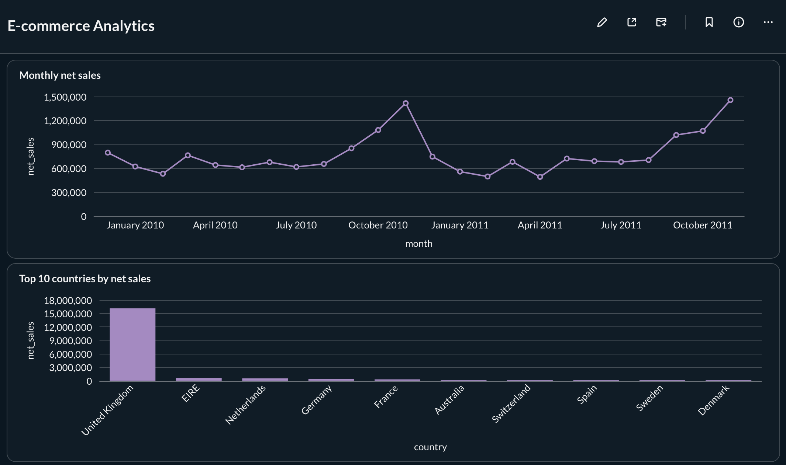
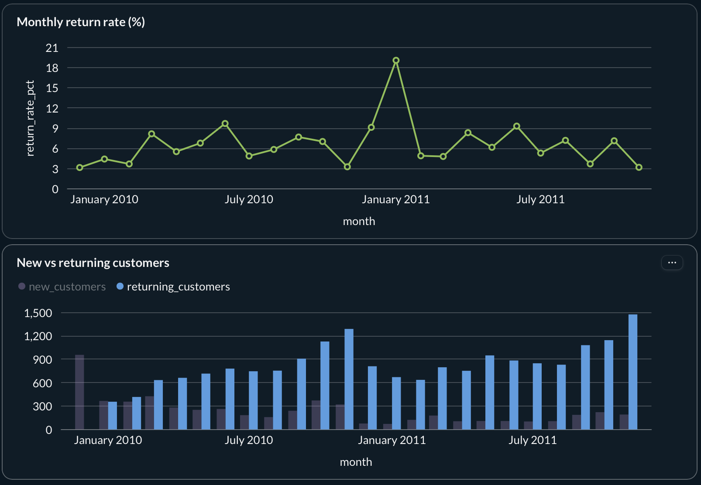
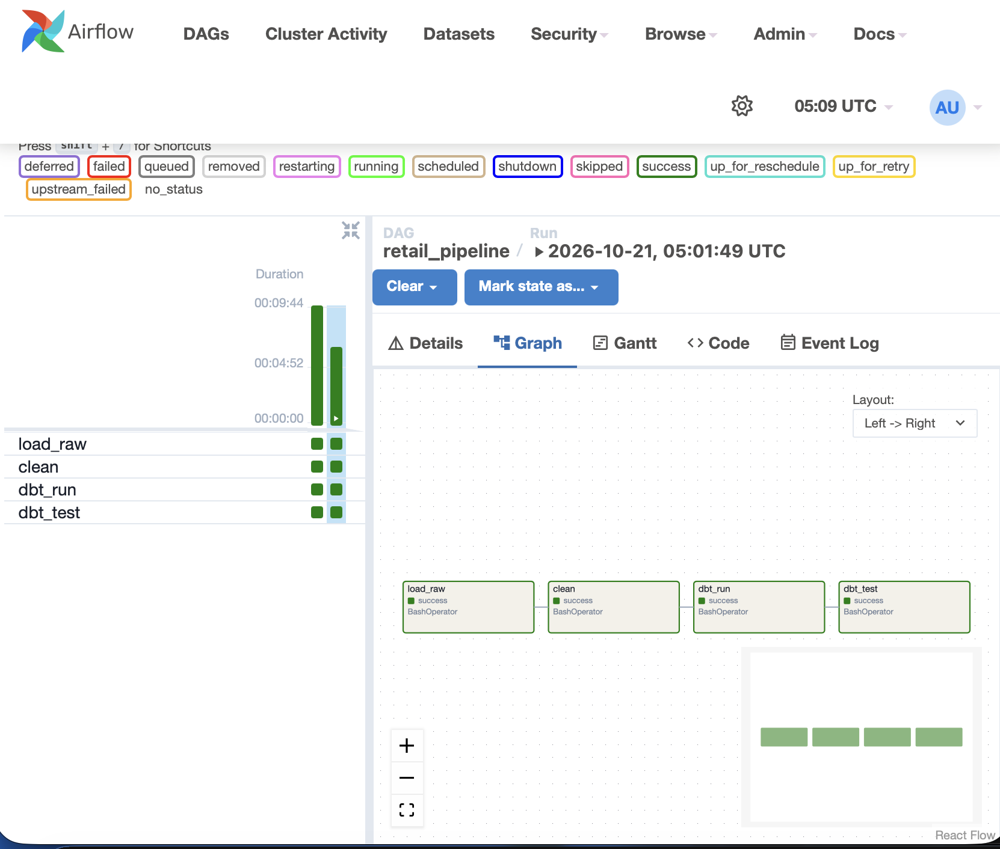
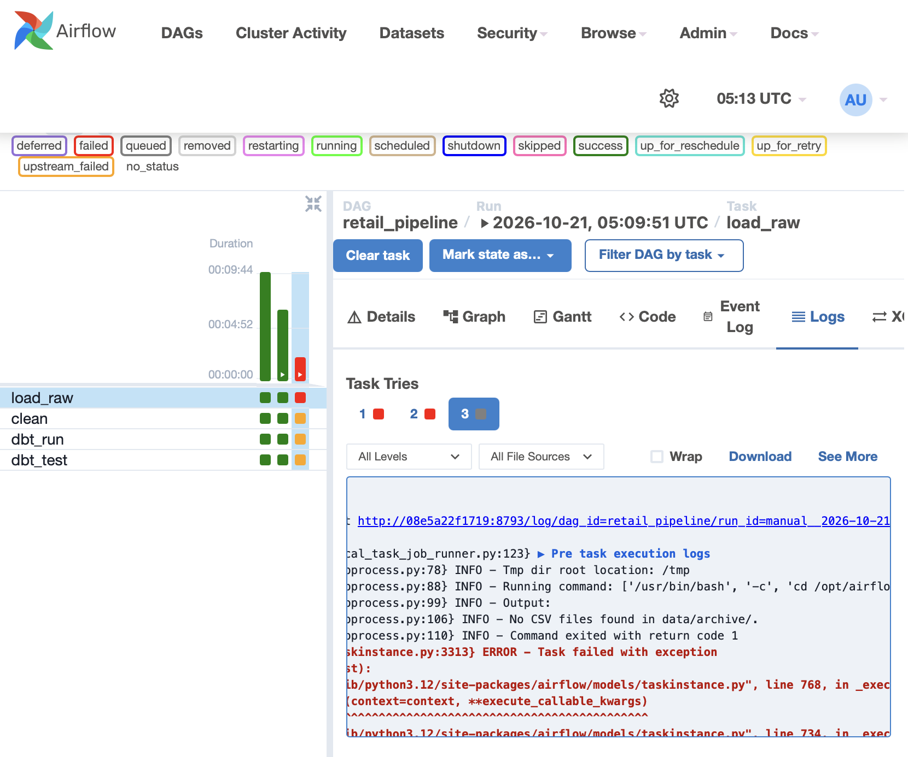

# E-commerce Analytics Warehouse

A small data pipeline I built to practice data engineering. It takes about 1 million rows of online store sales, cleans them, organizes them into tables that are easy to analyze, and shows the results on a dashboard. Everything runs on my laptop with Docker.

- Data: [Online Retail II](https://archive.ics.uci.edu/dataset/502/online+retail+ii), sales from a UK online gift shop (Dec 2009 to Dec 2011)
- Tools: Python, pandas, PostgreSQL, dbt, Airflow, Docker, Metabase




## How it works

The data goes through four steps. Each step saves its result in its own schema (a group of tables) in PostgreSQL.

```
CSV files -> raw -> staging -> analytics -> Metabase dashboard
```

1. **raw**: `load_raw.py` loads the CSV files exactly as they are. Every column is stored as text, so dirty values cannot break the load.
2. **staging**: `clean.py` uses pandas to remove duplicates, fix data types and flag problem rows.
3. **analytics**: dbt turns the clean data into a star schema (explained below) and runs tests on it.
4. **Metabase** reads the analytics tables and shows the charts.

I keep the raw layer so that if I find a bug in the cleaning, I can fix it and run again without downloading anything.

Every step can be run again safely. It replaces its own tables, so nothing gets duplicated.

## Cleaning

I checked the raw data with SQL first, then decided what to do with each problem:

- 34,335 rows were exact duplicates (the two yearly files overlap in December 2010). I removed them.
- 6,019 rows had a price of 0 or less. I moved them to `staging.rejected_rows` instead of deleting them, so I can always see what was removed.
- About 23% of rows had no customer ID. I kept them because they are real sales, and marked them with `has_customer = false`.
- Invoices starting with `C` are returns. I kept them and marked them `is_return = true` so I can measure returns.

The numbers add up: 1,067,371 raw rows - 34,335 duplicates = 1,033,036 = 1,027,017 clean rows + 6,019 rejected rows.

## The tables

A star schema has one big table with the events (sales) and small tables that describe them (who, what, when).

| Table | One row is... | Rows |
|---|---|---|
| `fact_sales` | one line on an invoice | 1,027,017 |
| `dim_customer` | one customer | 5,939 |
| `dim_product` | one product | 4,932 |
| `dim_date` | one calendar day | 739 |

The data has no unique ID for each invoice line, so I made one (`sales_key`) by hashing all the columns together.

## Tests

dbt runs 14 tests, and all pass:

- Every ID is unique and not empty.
- Every sale points to a customer, product and date that exist.
- The total sales amount in `fact_sales` matches the total in staging. This test failed the first time because of a rounding difference of 0.018 on 19 million, so I allowed a difference up to 1.

## Dashboard

There are four charts. The SQL for each one is in `metabase/queries/`.

1. Monthly net sales: sales peak in November in both years.
2. Top 10 countries: the United Kingdom is most of the revenue.
3. Monthly return rate: the value of returned items as a percent of sales.
4. New vs returning customers: from early 2010, there are more returning customers than new ones in most months.

In the three monthly charts, December 2011 is left out because the data stops on 9 December. In December 2009 every customer counts as new because the data starts there.

## Folders

```
data/archive/        CSV files (not in git)
ingestion/           load_raw.py, clean.py, create_raw.sql
retail_dbt/          dbt project (models, tests)
metabase/queries/    SQL for the dashboard charts
docker-compose.yml   PostgreSQL, Airflow and Metabase
airflow/             Airflow image and the DAG
```

## Scheduling with Airflow

An Airflow DAG called `retail_pipeline` runs the whole pipeline every day. It has four tasks that run in order: `load_raw`, `clean`, `dbt_run` and `dbt_test`. If a task fails, Airflow tries it again up to 2 times. If it still fails, the tasks after it do not run, and the failed task turns red so I can see the problem. If a data test fails, it also shows up as a red task instead of going unnoticed.

The pipeline code runs in its own Python environment inside the Airflow image, because Airflow and dbt need different package versions.





## How to run

You need Docker and the two CSV files from the dataset.

### Option 1: with Airflow

1. **Download the data first.** The CSV files are not in this repo because they are too big, so you have to add them yourself. Download the dataset (link at the top) and put the two files here:
   - `data/archive/online_retail_09_10.csv`
   - `data/archive/online_retail_10_11.csv`

   Check with `ls data/archive`. You should see both files. If the folder is empty, the load step will stop with an error.

2. Start everything. The first build takes a few minutes:
```bash
   docker compose up -d --build
```

3. Wait 2 to 3 minutes, then open http://localhost:8080 and log in with `admin` / `admin`. Switch on `retail_pipeline` and press the play button to run it.

4. When all four tasks are green, open Metabase at http://localhost:3000, create an account, and add a PostgreSQL database (host `postgres`, port `5432`, database `retail`, user `retail`, password `retail`). Then create the charts from the SQL files in `metabase/queries/`.

### Option 2: without Airflow

You also need Python 3.9 or newer. Do step 1 above first, then:

```bash
python3 -m venv .venv
source .venv/bin/activate
pip install -r requirements.txt
docker compose up -d postgres metabase
python ingestion/load_raw.py
python ingestion/clean.py
cd retail_dbt
dbt run
dbt test
```

Then do step 4 above for Metabase.